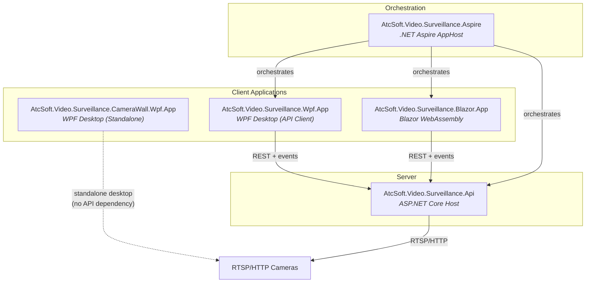
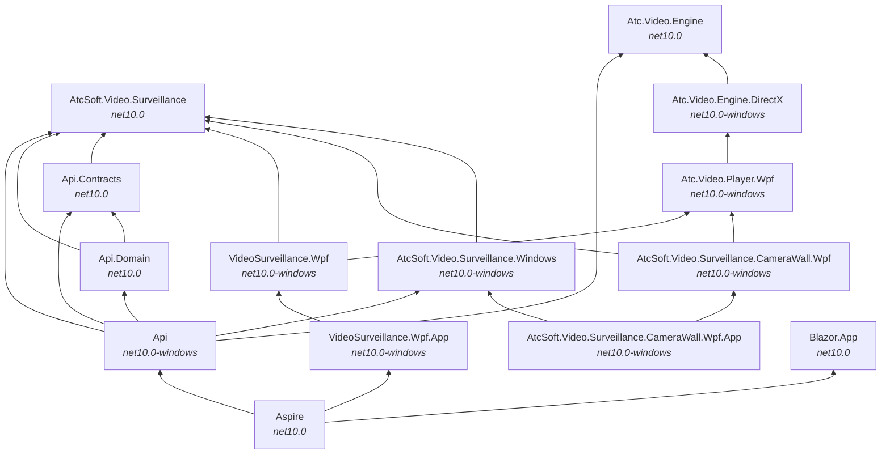
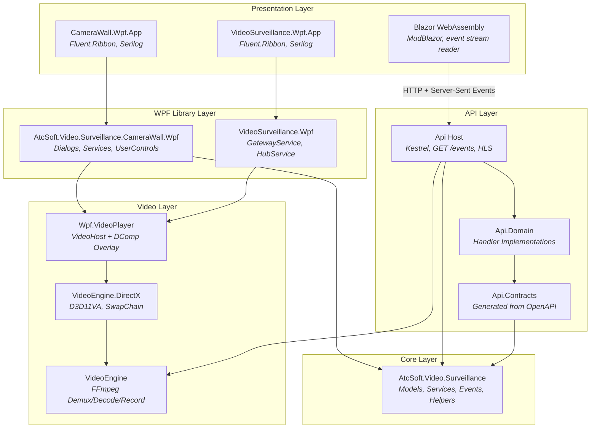
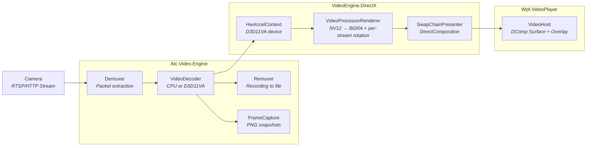
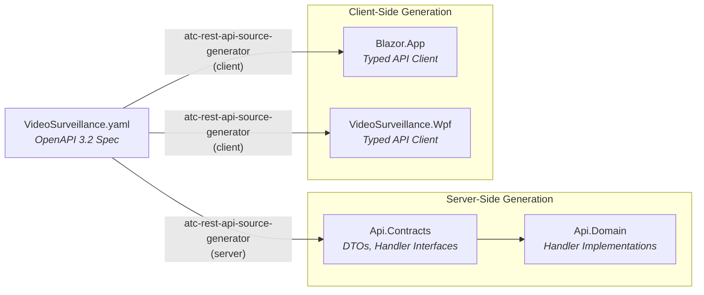
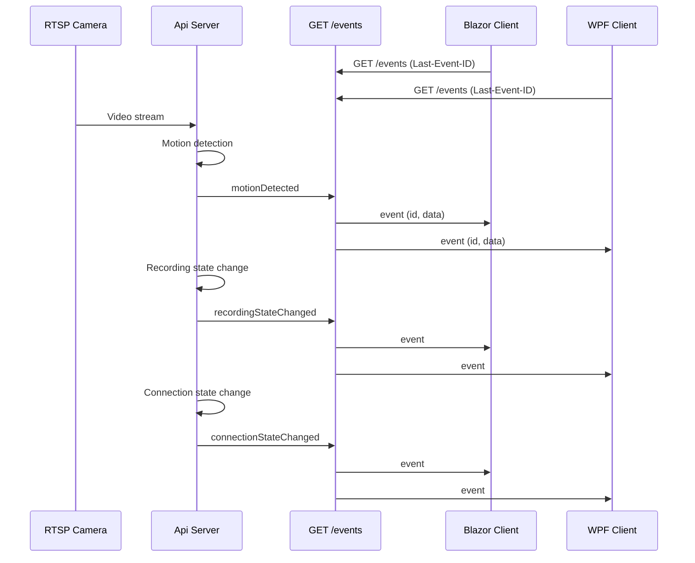
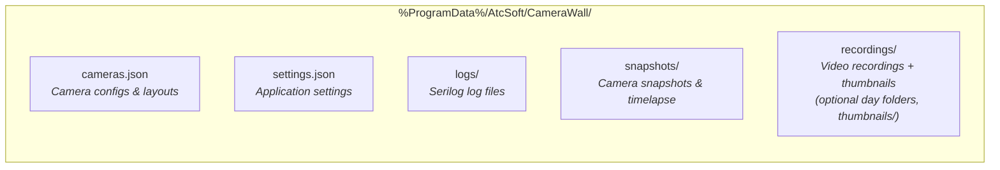
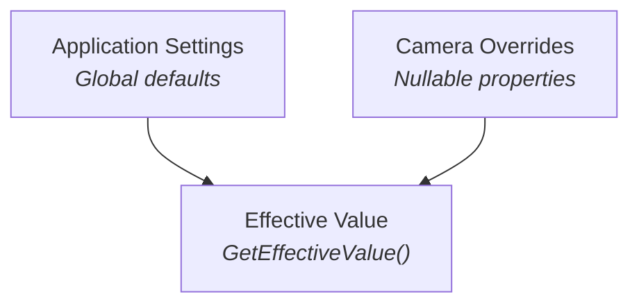

# 🏛️ AtcSoft.Video.Surveillance Architecture

A multi-assembly video surveillance platform supporting both a WPF desktop application and a headless REST API + Blazor Web UI, sharing a common Core library. Built on .NET 10.0 with in-process FFmpeg via Atc.Video.Engine.

## 🌐 High-Level Architecture

## 🔗 Assembly Dependency Graph

`AtcSoft.Video.Surveillance.Windows` is the optional Windows-only USB layer — Media Foundation device enumeration plus a WMI hot-plug watcher. The Core abstraction (`IUsbCameraEnumerator` / `IUsbCameraWatcher`) lives in `AtcSoft.Video.Surveillance` so non-Windows hosts can compose with `NullUsbCameraEnumerator` / `NullUsbCameraWatcher` and a future V4L2 / AVFoundation implementation can drop in without touching consumers. The `Api` host targets `net10.0-windows` so it can reference `VideoEngine.Windows` directly; Linux and macOS USB support is deferred (it is not on the roadmap).

## 📊 Layered Architecture

## 🎬 Video Pipeline Architecture

## 📝 OpenAPI-First API Design

## ⚡ Real-Time Event Flow

## 📦 Assembly Responsibilities

### 📚 Core Layer

| Assembly | Target | Description |
|----------|--------|-------------|
| **AtcSoft.Video.Surveillance** | net10.0 | Shared domain library with zero UI dependencies. Contains all models (camera configuration, layouts, settings, overrides, recording entries), enums (ConnectionState, RecordingState, CameraProtocol, etc.), events (motion detected, recording state changed, connection changed), service interfaces (ICameraStorageService, IApplicationSettingsService, IRecordingService, IMotionDetectionService, ITimelapseService, IMediaCleanupService, etc.), helpers (ApplicationPaths, CameraUriHelper, RecordingPolicyHelper), and factories (DropDownItemsFactory). |

### 🎬 Video Engine Layer

| Assembly | Target | Description |
|----------|--------|-------------|
| **Atc.Video.Engine** | net10.0 | Cross-platform video engine using in-process FFmpeg via Flyleaf.FFmpeg.Bindings. Provides `Demuxer` for packet extraction, `VideoDecoder` for CPU/GPU decoding, `Remuxer` for recording to file (MP4/MKV) — with optional `rotate` metadata for rotated streams — `FrameCapture` for PNG snapshots, and `MediaProbe` for stream metadata. Exposes `IVideoPlayer` and `IVideoPlayerFactory` interfaces. Defines `IGpuAccelerator` for pluggable hardware acceleration and a `VideoRotation` enum for per-stream rotation. |
| **Atc.Video.Engine.DirectX** | net10.0-windows | Windows-specific GPU acceleration using Direct3D 11. Implements `IGpuAccelerator` via `D3D11Accelerator` for D3D11VA hardware-accelerated decoding. Provides `VideoProcessorRenderer` (NV12 → BGRA, with optional 0/90/180/270° rotation via `VideoProcessorSetStreamRotation`), `SwapChainPresenter` (DirectComposition swap chain rendering), `HwAccelContext` (FFmpeg hardware device setup), and `GpuSnapshotCapture` (GPU-surface PNG capture). Uses Vortice bindings. |

### 🖥️ WPF Presentation Layer

| Assembly | Target | Description |
|----------|--------|-------------|
| **Atc.Video.Player.Wpf** | net10.0-windows | WPF `VideoHost` control that displays video via DirectComposition surface with XAML overlay support. Uses native window hierarchy (Surface Window + Overlay Window as WS_CHILD). Provides `OverlayBridge` for connecting WPF XAML elements to the native overlay window. |
| **AtcSoft.Video.Surveillance.CameraWall.Wpf** | net10.0-windows | WPF library containing the complete camera wall implementation (not published to NuGet; consumed by the CameraWall app). Includes: `CameraWallManager` facade, service implementations (storage, settings, recording, motion detection, timelapse, media cleanup, segmentation, thumbnails, GitHub updates), 7+ dialog windows (CameraConfiguration, Settings, RecordingsBrowser, AssignCamera, CheckForUpdates, About, InputBox), 38+ dialog part UserControls for settings/configuration, camera grid and tile UserControls, motion bounding box overlay, and localization resources (en-US, da-DK, de-DE). |
| **AtcSoft.Video.Surveillance.CameraWall.Wpf.App** | net10.0-windows | Thin shell WPF application. Provides `MainWindow` with Fluent.Ribbon UI (Layouts, Cameras, View, Help tabs). Configures `Microsoft.Extensions.Hosting`, Serilog file logging (daily rolling, 7-day retention), and DI registration via `AddDependencyRegistrationsFromCameraWall()`. |
| **AtcSoft.Video.Surveillance.Wpf** | net10.0-windows | WPF library for the VideoSurveillance API client. Provides `GatewayService` (OpenAPI-generated REST client split by resource: Cameras, Layouts, Recordings, Settings) and `SurveillanceEventService` (the `GET /events` reader for real-time events). Uses `Atc.Rest.Api.SourceGenerator` for typed API client generation from `VideoSurveillance.yaml`. |
| **AtcSoft.Video.Surveillance.Wpf.App** | net10.0-windows | Thin shell WPF application for the VideoSurveillance API client. Provides `MainWindow` with Fluent.Ribbon UI (Home tab with Cameras, Layouts, Recordings buttons). Status bar shows the server URL and whether the live updates are on. Configures `Microsoft.Extensions.Hosting`, Serilog, splash screen, and DI for `GatewayService` + `SurveillanceEventService`. Reads `ApiBaseAddress` from `appsettings.json`. |

### 🌍 Server Layer

| Assembly | Target | Description |
|----------|--------|-------------|
| **AtcSoft.Video.Surveillance.Api.Contracts** | net10.0 | Auto-generated from `VideoSurveillance.yaml` via atc-rest-api-source-generator. Contains request/response DTOs, handler interfaces (IListCamerasHandler, ICreateCameraHandler, etc.), and the host wiring (`AddVideoSurveillanceApi()` / `MapVideoSurveillanceApi()`). Errors are RFC 9457 ProblemDetails. Shared contract between server and client. |
| **AtcSoft.Video.Surveillance.Api.Domain** | net10.0 | Handler implementations for all API endpoints. 16 handlers covering Cameras CRUD (8), Layouts CRUD + Apply (5), Recordings (1), Settings (2). Includes mapping extensions for domain-to-DTO conversions. |
| **AtcSoft.Video.Surveillance.Api** | net10.0 | ASP.NET Core host application. Registers all services (JsonCameraStorageService, JsonApplicationSettingsService, ServerRecordingService, ServerMotionDetectionService, VideoPlayerFactory, StreamingService). Configures CORS, the camera events at `GET /events`, live streams on a lease (`POST /cameras/{id}/stream`), static file serving for HLS streams (`/streams`) and recordings (`/recordings-files`), OpenAPI docs via Scalar. Runs `CameraConnectionService` and `SurveillanceEventBroadcaster` as hosted services. |

### 🌐 Web UI

| Assembly | Target | Description |
|----------|--------|-------------|
| **AtcSoft.Video.Surveillance.Blazor.App** | net10.0 | Blazor WebAssembly client with MudBlazor UI. Pages: Dashboard (live stats), Cameras (CRUD + snapshot/record), Layouts (drag-drop grid editor), Live View (HLS streaming with motion bounding boxes), Recordings (browse/playback/download), Settings (7-tab configuration). Uses `GatewayService` for API calls and `EventStreamService` for real-time updates from `GET /events`. Auto-generated API client from OpenAPI spec. |

### ☁️ Orchestration

| Assembly | Target | Description |
|----------|--------|-------------|
| **AtcSoft.Video.Surveillance.Aspire** | net10.0 | .NET Aspire AppHost for distributed orchestration. Starts the API on port 5000, then the Blazor.App and Wpf.App with API service references. Provides Aspire dashboard for monitoring, logs, traces, and health checks. |

### ✅ Testing

| Assembly | Target | Description |
|----------|--------|-------------|
| **AtcSoft.Video.Surveillance.Tests** | net10.0 | xUnit v3 unit tests for Core library. Tests models, enums, events, extensions, factories, and helpers. Uses AutoFixture, AwesomeAssertions, and NSubstitute. |
| **Atc.Video.Engine.Tests** | net10.0 | xUnit v3 unit tests for VideoEngine. Tests FFmpeg integration, video player, and frame capture. |
| **AtcSoft.Video.Surveillance.Api.Tests** | net10.0 | xUnit v3 unit tests for API handlers and domain logic. Tests CRUD operations and mapping extensions. |

### 📦 Installer

| Assembly | SDK | Description |
|----------|-----|-------------|
| **AtcSoft.Video.Surveillance.Installer** | WixToolset.Sdk 5.0.2 | WiX MSI installer for the desktop application. Auto-harvests published binaries via WiX Heat. Produces x64 Windows Installer package with Start Menu and Desktop shortcuts. Built via command line only (excluded from Visual Studio solution). |

## 🛠️ Key Technology Stack

| Component | Technology |
|-----------|------------|
| Framework | .NET 10.0 / C# 14.0 |
| Desktop UI | WPF with Fluent.Ribbon, Atc.Wpf.Controls |
| Web UI | Blazor WebAssembly with MudBlazor |
| Server | ASP.NET Core, Server-Sent Events, HLS |
| API Definition | OpenAPI 3.2 (atc-rest-api-source-generator v3) |
| Video Engine | Atc.Video.Engine (in-process FFmpeg via Flyleaf.FFmpeg.Bindings) |
| GPU Acceleration | Direct3D 11 (D3D11VA) via Vortice bindings |
| Rendering | DirectComposition swap chain |
| Orchestration | .NET Aspire |
| MVVM | Atc.XamlToolkit (source generators) |
| DI Registration | Atc.SourceGenerators (`[Registration]` attribute) |
| Theming | Atc.Wpf.Theming |
| Logging | Serilog (console + file sink) |
| Testing | xUnit v3, AutoFixture, AwesomeAssertions, NSubstitute |
| Versioning | release-please (Conventional Commits) |
| Code Analysis | StyleCop, Meziantou, SonarAnalyzer, SecurityCodeScan |
| Installer | WiX Toolset v5 |

## 💾 Data Storage

Both the WPF app and the API server use the same JSON-based storage format under `%ProgramData%\AtcSoft\CameraWall\`. The `ApplicationPaths` helper in Core provides default paths.

## 🔀 Per-Camera Override System

Every application-level setting can be overridden on a per-camera basis. Override models use nullable properties where `null` means "use application default":

Override categories: Connection, CameraDisplay, Performance, Recording, MotionDetection (with nested BoundingBox).

## 🔧 Service Registration

Services are auto-registered using `[Registration]` source-generated attributes:

- **WPF**: `services.AddDependencyRegistrationsFromCameraWall(includeReferencedAssemblies: true)` registers all services from the CameraWall library and referenced Core assembly.
- **API**: Explicit singleton registration in `Program.cs` for server-specific service implementations (JsonCameraStorageService, ServerRecordingService, etc.).
